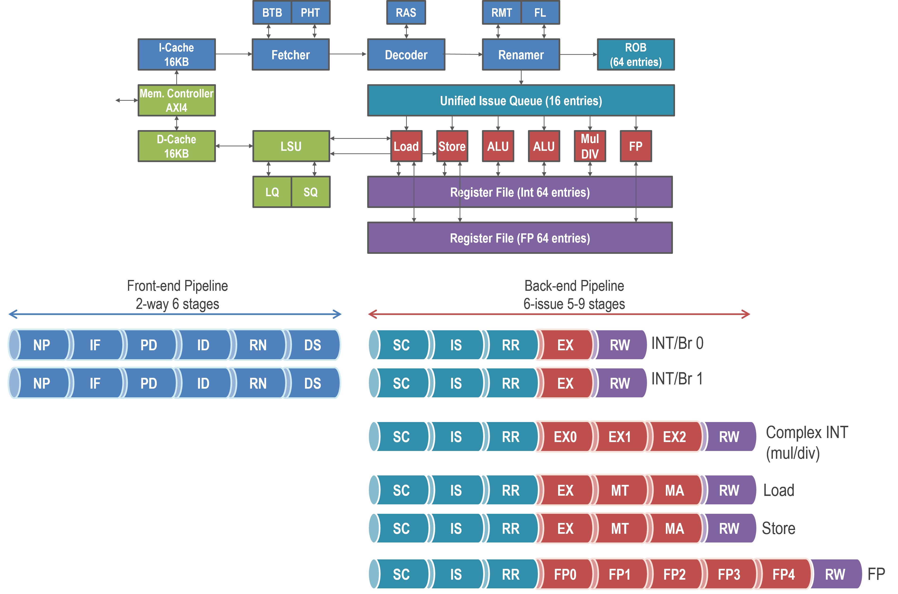
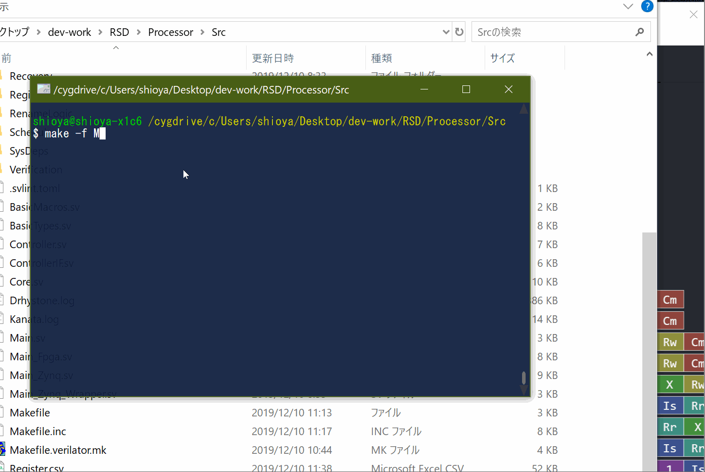

# RSD RISC-V アウトオブオーダ・スーパースカラプロセッサ

[English](README.md) | [日本語](README.ja.md)

RSDは32ビットRISC-Vのアウトオブオーダ・スーパースカラプロセッサコアです．
積極的なアウトオブオーダ実行による高い性能と，小規模なFPGAにも合成できるコンパクトさの両立を目指しています．
主な特徴は次のとおりです．

* ISA
    * RV32IMAF，Zicsr，Zifencei，Zba，Zicondに対応
    * Zicfilpによるランディングパッド保護を選択可能
    * M/S/U特権モードに対応（MMUなし）
    * Zephyrアプリケーションを実行可能
* マイクロアーキテクチャ
    * パイプライン幅，キュー・レジスタ数，キャッシュのパラメータをビルド時に設定可能
        * 既定値は[MicroArch.toml](Processor/Config/MicroArch.toml)で設定
        * 既定構成は2命令幅フェッチ，最大6命令幅発行，64エントリのリオーダバッファ
    * リプレイ機構を備えた高速な投機的命令スケジューラ
    * ロード・ストアの投機的アウトオブオーダ実行と動的なメモリ依存関係判定
    * ノンブロッキングL1データキャッシュ
    * AXI4バスに対応
* 実装
    * SystemVerilogによる記述
    * Verilator，ModelSim/QuestaSim，XSimによるRTLシミュレーション
    * Synplify，Vivado，Design Compilerで合成可能
        * Design Compilerへの対応は実験的
    * Xilinx Zynqボードで動作可能
        * Avnet Zedboard
    * FPGA向けに最適化したRAM構造



## はじめに

### Dev Containerでシミュレーションする

以下では，Ubuntu 24.04でDev Containerを使ってシミュレーションする方法を説明します．
まず，Dockerと[Dev Container CLI](https://github.com/devcontainers/cli#npm-install)を導入します．

```bash
sudo apt update
sudo apt install -y docker.io docker-buildx python3 build-essential nodejs npm
sudo systemctl enable --now docker
sudo usermod -aG docker "$USER"
sudo npm install -g @devcontainers/cli@0.83.3  # Ubuntu 24.04のNode.js 18に対応
```

Dockerグループへの追加を反映するため，一度ログアウトしてログインし直してください．その後，リポジトリのルートで次を実行します．

```bash
./RunContainer.sh                # コンテナ内のシェルを開く
make -j"$(nproc)"                # Verilatorシミュレータをビルド
make test/level-1/run            # 基本テストをビルドして実行
```

`test/level-1/run`はテスト用HEXファイルを自動でビルドし，成功すると`Test Successful (test/level-1/run)`と表示します．

初回起動時にコンテナ環境を構築します．
以後は環境を再利用し，設定が変わったときに再構築します．
コマンド実行や再構築のオプションは，ホスト側のリポジトリのルートで`./RunContainer.sh --help`を実行すると確認できます．

テスト後，リポジトリのルートで次を実行すると，Fibonacciのパイプライン動作を可視化できます．

```bash
make sim/kanata TEST_CODE=Verification/TestCode/C/Fibonacci
```

生成された`Processor/Src/Kanata.log`を[Konata](https://github.com/shioyadan/Konata/releases)で開いてください．



### 手動で環境を導入する

手動で導入する場合は，Dev Containerの設定を正本としてください．

1. [.devcontainer/Dockerfile](.devcontainer/Dockerfile)に記載されたベースOS，パッケージ導入，ツールのビルド手順に従います．ツールのバージョンも指定に合わせてください．
2. [SetEnv.sh](Processor/Tools/SetEnv/SetEnv.sh)を`Processor/Tools/SetEnv/MySetEnv.sh`へコピーしてツールのパスを編集し，`source Processor/Tools/SetEnv/MySetEnv.sh`を実行します．

準備ができたら，リポジトリのルートから上記と同じ`make`コマンドを使用します．

### シミュレーションの実行

既定のシミュレータはVerilatorです．
ModelSim/QuestaSimやVivadoも，別途インストールすれば使用できます．
ModelSim/QuestaSimは`make SIM=modelsim`，XSimは`make SIM=xsim`で選択します．

テスト用HEXファイルはDev Container内でビルドし，ホスト側にインストールされたVivadoのXSimなどのシミュレータをコンテナの外で実行できます．
ホスト側にVivado，GNU Make，Python 3.11以上を用意し，同じチェックアウトを使って，ホスト側のリポジトリのルートで次を順に実行します．
ツールのパスは，環境変数のほか，次のようにmakeの引数でも指定できます．

```bash
./RunContainer.sh make test/level-1/build  # コンテナ内でテスト用HEXをビルド
make SIM=xsim RSD_VIVADO_BIN=/PATH/TO/VIVADO/BIN sim/build  # ホスト側でRTL・テストベンチをビルド
make SIM=xsim RSD_VIVADO_BIN=/PATH/TO/VIVADO/BIN test/level-1/run  # ホスト側でテストを実行
```


### Xilinx Zynqボードで動かす

* [RSD Wikiの手順](https://github.com/rsd-devel/rsd/wiki/en-fpga-zynq-synth-for-linux)を参照してください．

## ドキュメント

* [RSD Wiki](https://github.com/rsd-devel/rsd/wiki)を参照してください．

## ライセンス

Copyright 2019-2026 Ryota Shioya (shioya@ci.i.u-tokyo.ac.jp) and RSD contributors.
貢献者についてはCREDITS.mdも参照してください．本実装はApache License, Version 2.0のもとで公開されています．
詳細はLICENSEを参照してください．

## 参考文献

Susumu Mashimo et al., "An Open Source FPGA-Optimized Out-of-Order RISC-V Soft
Processor", IEEE International Conference on Field-Programmable Technology (FPT), 2019.
[論文のPDF](https://www.rsg.ci.i.u-tokyo.ac.jp/members/shioya/pdfs/Mashimo-FPT'19.pdf)を公開しています．
