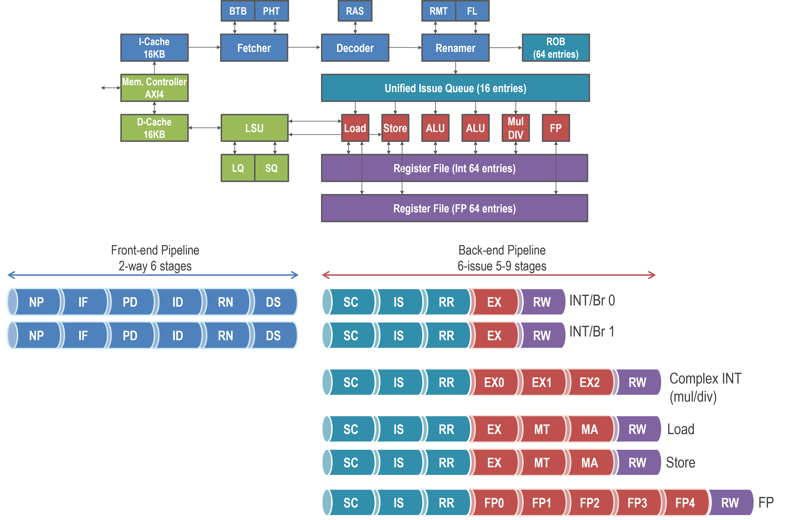
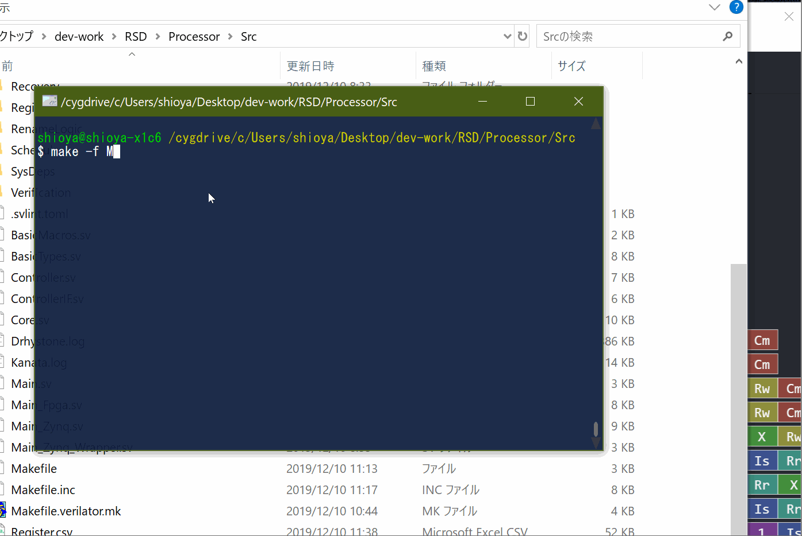

# RSD RISC-V Out-of-Order Superscalar Processor

[English](README.md) | [Japanese](README.ja.md)

RSD is a 32-bit RISC-V out-of-order superscalar processor core.
RSD aims to combine high performance through aggressive out-of-order execution with a compact design that fits small FPGAs.
The key features of RSD are as follows:

* ISA
    * Support for RV32IMAF, Zicsr, Zifencei, Zba, and Zicond
    * Optional Zicfilp landing-pad protection
    * M/S/U privilege modes (no MMU)
    * Support for Zephyr applications
* Microarchitecture
    * Build-time configurable pipeline widths, queue/register counts, and cache parameters
        * Configure defaults in [MicroArch.toml](Processor/Config/MicroArch.toml)
        * Default configuration: 2-wide fetch, up to 6-wide issue, and a 64-entry reorder buffer
    * A high-speed speculative instruction scheduler with a replay mechanism
    * Speculative OoO load/store execution and dynamic memory disambiguation
    * Non-blocking L1 data cache
    * Support for the AXI4 bus
* Implementation
    * Written in SystemVerilog
    * RTL simulation with Verilator, ModelSim/QuestaSim, and XSim
    * Can be synthesized with Synplify, Vivado and Design Compiler
        * Design Compiler support is experimental
    * Can run on a Xilinx Zynq board
        * Avnet Zedboard
    * FPGA optimized RAM structures



## Getting started

### Simulation with the dev container

The following instructions describe simulation with a dev container on Ubuntu 24.04.
First, install Docker and the [Dev Container CLI](https://github.com/devcontainers/cli#npm-install):

```bash
sudo apt update
sudo apt install -y docker.io docker-buildx python3 build-essential nodejs npm
sudo systemctl enable --now docker
sudo usermod -aG docker "$USER"
sudo npm install -g @devcontainers/cli@0.83.3  # Compatible with Ubuntu 24.04's Node.js 18
```

Log out and log back in to apply Docker group membership, then run from the repository root:

```bash
./RunContainer.sh                # Open a shell in the container
make -j"$(nproc)"                # Build the Verilator simulator
make test/level-1/run            # Build and run the basic tests
```

`test/level-1/run` builds the test HEX files automatically and prints `Test Successful (test/level-1/run)` on success.

The first launch builds the container environment.
Later launches reuse it and rebuild when its configuration changes.
From the host repository root, use `./RunContainer.sh --help` for command execution and rebuild options.

After the tests, visualize the Fibonacci pipeline from the repository root:

```bash
make sim/kanata TEST_CODE=Verification/TestCode/C/Fibonacci
```

Open the generated `Processor/Src/Kanata.log` with [Konata](https://github.com/shioyadan/Konata/releases).



### Manual installation

Use the dev container configuration as the reference for manual setup:

1. Follow the base OS, package installation, and tool build steps in [.devcontainer/Dockerfile](.devcontainer/Dockerfile), including its specified tool versions.
2. Copy [SetEnv.sh](Processor/Tools/SetEnv/SetEnv.sh) to `Processor/Tools/SetEnv/MySetEnv.sh`, edit the tool paths, and run `source Processor/Tools/SetEnv/MySetEnv.sh`.

Once setup is complete, use the same `make` commands above from the repository root.

### Running simulations

Verilator is the default simulator.
ModelSim/QuestaSim and Vivado can also be used if installed separately.
Select ModelSim/QuestaSim with `make SIM=modelsim`, or XSim with `make SIM=xsim`.

You can build test HEX files inside the dev container and run simulations outside it using tools installed on the host, such as Vivado's XSim.
Install Vivado, GNU Make, and Python 3.11 or newer on the host, then run these commands in order from the host repository root, using the same checkout.
Tool paths can be set through environment variables or passed as make arguments, as shown below.

```bash
./RunContainer.sh make test/level-1/build  # Build test HEX files inside the container
make SIM=xsim RSD_VIVADO_BIN=/PATH/TO/VIVADO/BIN sim/build  # Build the RTL and testbench on the host
make SIM=xsim RSD_VIVADO_BIN=/PATH/TO/VIVADO/BIN test/level-1/run  # Run tests on the host
```

### Run on a Xilinx Zynq board

* See [this RSD wiki page](https://github.com/rsd-devel/rsd/wiki/en-fpga-zynq-synth-for-linux).

## Documents

* See [RSD Wiki](https://github.com/rsd-devel/rsd/wiki).

## License

Copyright 2019-2026 Ryota Shioya (shioya@ci.i.u-tokyo.ac.jp) and RSD contributors,
see also CREDITS.md. This implementation is released under the Apache License,
Version 2.0, see LICENSE for details.

## References

Susumu Mashimo et al., "An Open Source FPGA-Optimized Out-of-Order RISC-V Soft
Processor", IEEE International Conference on Field-Programmable Technology (FPT), 2019. A PDF of the paper is available [here](https://www.rsg.ci.i.u-tokyo.ac.jp/members/shioya/pdfs/Mashimo-FPT'19.pdf).
