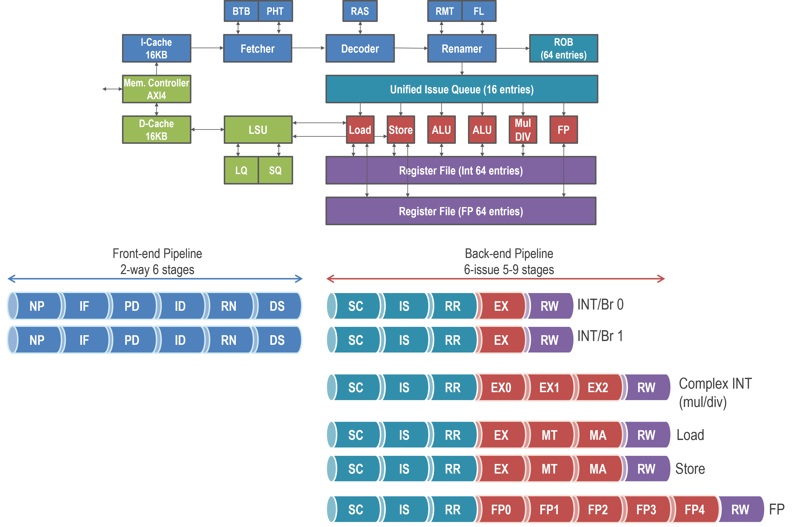
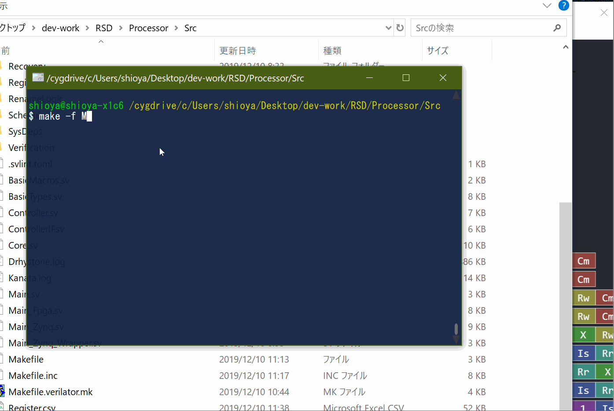

# RSD RISC-V Out-of-Order Superscalar Processor 

RSD is a 32-bit RISC-V out-of-order superscalar processor core.
RSD is very fast due to aggressive OoO features, while it is very compact and can be synthesized for small FPGAs. 
The key features of RSD are as follows:

* ISA
    * Support RV32IMF
    * Support Zephyr applications
* Microarchitecture
    * 2-fetch front-end and 6-issue back-end pipelines
    * Up to 64 instructions are in-flight.
        * These parameters can be configurable.
    * A high-speed speculative instruction scheduler with a replay mechanism
    * Speculative OoO load/store execution and dynamic memory disambiguation
    * Non-blocking L1 data cache
    * Support AXI4 bus
* Implementation
    * Written in SystemVerilog
    * Can be simulated with Modelsim/QuestaSim, Verilator, and Vivado
    * Can be synthesized with Synplify, Vivado and Design Compiler 
        * Design Compiler support is experimental
    * Can run on a Xilinx Zynq board  
        * Avnet Zedboard  
    * FPGA optimized RAM structures
 



## Getting started

### Simulation with the dev container

On a fresh Ubuntu 24.04 installation, install Docker and the [Dev Container CLI](https://github.com/devcontainers/cli#npm-install).
If Docker is already installed, skip its installation and group setup:

```bash
sudo apt update
sudo apt install -y docker.io docker-buildx python3 build-essential nodejs npm
sudo systemctl enable --now docker
sudo usermod -aG docker "$USER"
sudo npm install -g @devcontainers/cli@0.83.3  # Compatible with Ubuntu 24.04's Node.js 18
```

Log out and log back in to apply Docker group membership, then run from the repository root:

```bash
./DevContainer.sh                     # Open a shell in the container
cd Processor/Src
make -j"$(nproc)" -f Makefile.verilator.mk  # Build the simulator
make -f Makefile.verilator.mk test-1       # Build and run the basic tests
```

`test-1` builds the test HEX files automatically and prints `Test Successful (test-1)` on success.
See the [test program instructions](Processor/Src/Verification/TestCode/README.md) for FP configurations and CoreMark.
The first launch builds the environment; later launches reuse it and rebuild when its configuration changes.
From the host repository root, use `./DevContainer.sh --help` for command execution and rebuild options.
With VS Code's Dev Containers extension, you can instead use **Reopen in Container** and run the same `cd` and `make` commands.

After the tests, visualize the Fibonacci pipeline from the same `Processor/Src` directory:

```bash
make -f Makefile.verilator.mk kanata TEST_CODE=Verification/TestCode/C/Fibonacci
```

Open the generated `Kanata.log` with [Konata](https://github.com/shioyadan/Konata/releases).



### Manual installation

Use the dev container configuration as the reference for manual setup:

1. Follow the base OS, package installation, and tool build steps in [.devcontainer/Dockerfile](.devcontainer/Dockerfile), including its specified tool versions.
2. Install the Python dependencies from [.devcontainer/requirements.txt](.devcontainer/requirements.txt).
3. Export the variables listed under `containerEnv` in [.devcontainer/devcontainer.json](.devcontainer/devcontainer.json), setting `RSD_ROOT` to your checkout's absolute path and adjusting tool paths for your host.

Then, from the repository root, use the same `cd` and `make` commands above.
ModelSim/QuestaSim and Vivado are also supported with separate installations;
see the [environment settings](https://github.com/rsd-devel/rsd/wiki/en-devel-environment-variables).
For ModelSim/QuestaSim, build with `make rtl`; for XSim (Vivado Simulator), use `make -f Makefile.xsim.mk`.

### Run on a Xilinx Zynq board

* See [this RSD wiki page](https://github.com/rsd-devel/rsd/wiki/en-fpga-zynq-synth-for-linux).

## Documents

* See [RSD Wiki](https://github.com/rsd-devel/rsd/wiki).

## License

Copyright 2019-2023 Ryota Shioya (shioya@ci.i.u-tokyo.ac.jp) and RSD contributors, 
see also CREDITS.md. This implementation is released under the Apache License,
Version 2.0, see LICENSE for details. This implementation integrates third-party 
packages in accordance with the licenses presented in THIRD-PARTY-LICENSES.md.

## References

Susumu Mashimo et al., "An Open Source FPGA-Optimized Out-of-Order RISC-V Soft 
Processor", IEEE International Conference on Field-Programmable Technology (FPT), 2019. A pre-print version is [here](https://www.rsg.ci.i.u-tokyo.ac.jp/members/shioya/pdfs/Mashimo-FPT'19.pdf).
